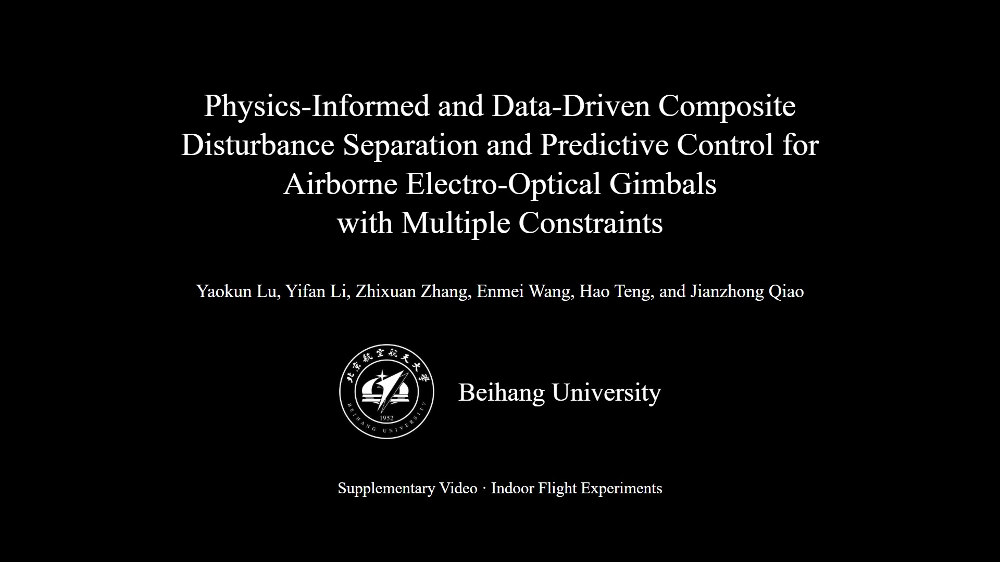

# Airborne gimbal disturbance separation and MPC

Reproducibility materials accompanying the manuscript **Physics-Informed and Data-Driven Composite Disturbance Separation and Predictive Control for Airborne Electro-Optical Gimbals with Multiple Constraints**.

The repository contains the simulation controllers, frozen test results, learned-model weights, the numerical experimental-controller snapshot, processed yaw/pitch flight series, figure scripts, and flight footage.

## Demonstration videos

**[Watch online with video controls](https://awilonk.github.io/airborne-gimbal-mpc-ds/)**

- [Download the revised 21-second four-method comparison](https://raw.githubusercontent.com/Awilonk/airborne-gimbal-mpc-ds/main/media/supplementary-video-1.mp4)
- [Download Proposed-method hovering footage (4x playback)](https://raw.githubusercontent.com/Awilonk/airborne-gimbal-mpc-ds/main/media/proposed-hover-4x.mp4)
- [Download four recorded flight clips in sequence (4x playback)](https://raw.githubusercontent.com/Awilonk/airborne-gimbal-mpc-ds/main/media/four-method-flight-clips-4x.mp4)

[](https://awilonk.github.io/airborne-gimbal-mpc-ds/)

GitHub's repository file viewer may refuse to preview these MP4 files because of their size. Use the **Watch online** page or download an MP4 instead.

The main video is the revised submission copy, with the current paper title and method names. It has been copied byte-for-byte from the approved video. Its panels show recordings from separate trials, with metrics from the updated plain-PID data. The earlier author-provided 21-second file remains in `media/` for provenance.

The sequential footage concatenates four separate hover trials in the order Proposed, learned-residual disabled, earlier PID, and LADRC (7.5 s per clip). It is not a simultaneous flight. The retained PID imagery comes from the earlier recording; the **plain-PID numerical baseline in the paper is the later 07:50 batch**, and is not synchronized to that earlier PID image. Use `data/flight/pid.csv` for the reported plain-PID metrics.

## Reproduce the figures

Python 3.10 or newer:

```sh
python -m pip install -r requirements.txt
python scripts/plot_flight.py
python scripts/plot_simulation.py
python scripts/check_reproduction.py
```

Fonts use Times New Roman when installed and otherwise the system serif fallback. Data and numerical metrics do not depend on the installed font.

## Re-run the simulation experiments

```sh
cd simulation/paper_sec4_20261022
python run_sec4.py --jobs 4
python run_sec4_rho.py --jobs 4
```

The first command generates the base controllers and the second adds drift-weighted MPC-DS and its ablations. These commands overwrite the local result cache; the committed files preserve the paper's frozen results. Test seeds are 100–109, four base frequencies are 0.5/1/1.5/2 Hz, each run lasts 30 s, and the switch is at 20 s. The nominal and calibrated plants, mismatch settings, tuning budget, and internal method IDs are recorded in the source and results JSON. `docs/method-names.json` maps the internal IDs to the manuscript names.

`simulation/bench_lstm_retune_rho.py` and `simulation/bench_lead_resid_rho.py` contain the learned-component comparisons. Training code and frozen NumPy inference weights are included. Training additionally requires PyTorch; the plotting and inference dependencies are listed separately from this optional training dependency.

## Experimental data and controller

`experimental_controller/` is the local numerical-controller snapshot used by the experimental software. It includes the two-axis configuration, frozen network, observer and MPC components, engineering baselines, and their local module dependencies. `data/flight/plain-pid-trial-protocol.json` records the actual later PID trial configuration; the standalone controller config is its local source snapshot rather than a substitute for a trial manifest. The archived ground IO module imports no autopilot arming/takeoff service; plotting and numerical checks do not instantiate hardware IO. No hardware connection is needed to reproduce the reported plots.

The flight data contain one 30-s trial per method. RMSE uses original samples over 5–28 s; no signal filtering or resampling is applied. The joint metric is `sqrt(mean(e_yaw**2 + e_pitch**2))` in degrees, rather than the mean of the two axis RMSEs. It is synchronous error in the yaw–pitch coordinate plane, not nearest-circle distance or independently calibrated inertial LOS error.

| Method | Yaw RMSE (deg) | Pitch RMSE (deg) | Joint RMSE (deg) |
|---|---:|---:|---:|
| PID | 1.824 | 1.454 | 2.333 |
| LADRC | 1.029 | 0.646 | 1.215 |
| MPC-DS w/o LR | 0.841 | 0.363 | 0.916 |
| MPC-DS (Proposed) | 0.770 | 0.350 | 0.846 |

MPC-DS w/o LR disables only the learned lead residual and retains the linear lead term. The main simulation's model-based MPC-DS core disables learning and the complete lead correction; it is a different ablation scope. The frequency-preview comparison implements the nominal certainty-equivalence structure of the cited method, not its complete tube-robust algorithm. The manuscript provides the full attribution and assumptions.

One trial per method and different recording batches do not establish statistical significance or broad flight generalization. Controlled simulation tests assess disturbance separation and frequency adaptation; the hover data show implementation and two-axis tracking in the tested condition.

## Verification

On 2026-10-24, `check_reproduction.py`, `plot_flight.py`, and `plot_simulation.py` all completed successfully in a fresh checkout. The four flight RMSEs and one representative 30-s MPC-DS simulation trace matched the frozen paper data. This check does not re-run every training or Monte Carlo sweep. See `docs/repository_verification.json`.

## Verification

On 2026-10-24, `check_reproduction.py`, `plot_flight.py`, and `plot_simulation.py` all completed successfully in a fresh checkout. The four flight RMSEs and one representative 30-s MPC-DS simulation trace matched the frozen paper data. This check does not re-run every training or Monte Carlo sweep. See `docs/repository_verification.json`.

## Provenance

`manifest.json` records SHA-256 hashes of published source/data/media. Original experiment archives and phone recordings remain preserved separately; this repository contains the processed series needed for the figures. Additional raw data are available from the authors on request.
